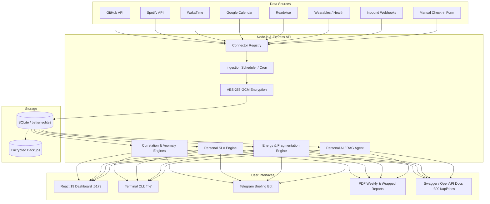

# 🧬 Personal API — The Operating System for Your Life

<div align="center">

[](https://www.typescriptlang.org/)
[](https://nodejs.org/)
[](https://react.dev/)
[](https://vitejs.dev/)
[](https://www.sqlite.org/)
[](https://www.docker.com/)
[](https://opensource.org/licenses/MIT)

**A self-hosted, privacy-first API and real-time cybernetic dashboard that aggregates your digital exhaust, health telemetry, habits, and life events into an AI-augmented personal intelligence platform.**

[Features](#-key-features) • [Architecture](#-architecture) • [Quick Start](#-quick-start) • [Interactive CLI](#-interactive-cli-me) • [API Reference](#-api-endpoints) • [Self-Hosting](#-self-hosting--docker)

</div>

---

## 📖 Overview

Your life generates thousands of digital data points every single day: code commits on GitHub, music tracks on Spotify, deep sleep cycles from smart wearables, focus sessions on WakaTime, meetings on Google Calendar, and book highlights on Readwise. 

Yet this data is fragmented across proprietary silos, monetized by third parties, and rarely correlated.

**Personal API** reverses this paradigm. It acts as the central **Operating System for Your Life**:
- 🛡️ **100% Sovereign & Self-Hosted:** Stored locally in a high-performance SQLite time-series database with zero third-party telemetry.
- ⚡ **Cross-Domain Correlation Engine:** Discovers hidden statistical relationships (e.g., *Does listening to ambient music or getting >7.5h sleep correlate with higher git commit velocity?*).
- 🚨 **Personal SLA & Anomaly Detection:** Monitors your life habits like DevOps uptime (e.g., 99.9% uptime on sleep and deep work), alerting you to burnout before it strikes.
- 🤖 **Private AI Agent with RAG:** Chat directly with your life data using local LLMs (Ollama / Llama 3) or OpenAI.
- 📱 **Omnichannel Access:** Access your status from a sleek web dashboard, an interactive CLI tool (`me`), a Telegram morning briefing bot, or automated weekly PDF reports.

---

## ✨ Key Features

### 🔌 1. Unified Ingestion & Connectors
- **GitHub:** Ingests commits, repositories, languages, and coding streaks via Personal Access Tokens.
- **Spotify:** Ingests recently played tracks, genres, top artists, and musical audio features.
- **Health & Wearables:** Aggregates sleep duration, sleep score, HRV, resting heart rate, and step count (Apple Health, Oura, Fitbit).
- **WakaTime:** Tracks exact IDE coding time per language, project, and editor.
- **Google Calendar:** Ingests meeting loads, computes calendar fragmentation, and identifies deep work focus windows.
- **Readwise / Kindle:** Ingests reading velocity, active books, and highlighted quotes.
- **Manual Quick-Checkins:** Interactive web and CLI logging for subjective 1–10 mood, energy, and contextual notes.
- **Inbound Webhooks:** Real-time push listener (`POST /api/v1/webhooks/:source`) for instant IoT, Shortcut, or service sync.

### 📊 2. Cybernetic Glassmorphism Dashboard
- Built with **React 19**, **Vite**, **Recharts**, and **Lucide Icons**.
- Dark cybernetic glassmorphism theme (`index.css`) with responsive mobile & desktop grids.
- Real-time telemetry cards: Life Snapshot Hero, Commit Activity Feed, Wellbeing trend areas, Habit Streaks, Active Goals with velocity forecasts, and "On This Day" retrospectives.

### 🧠 3. Statistical Intelligence & Anomaly Detection
- **Cross-Domain Correlations:** Computes Pearson and Spearman correlation matrices across sleep, mood, productivity, and music with $p < 0.05$ statistical significance filtering.
- **Dynamic Anomaly Engine:** Calculates 30-day rolling baselines and flags Z-score outliers ($|Z| > 2.0$) for abnormal sleep deficits, screen time spikes, or mood drops.

### 🎯 4. DevOps-Style Personal SLA & Goals
- Tracks your habits like high-availability server infrastructure (e.g., 30-day uptime percentage for sleep targets, daily exercise, and deep work).
- Goal pace forecaster predicting year-end completion dates and daily required velocity.

### ⚡ 5. Cognitive Fragmentation & Energy Accounting
- **Calendar Fragmentation Score (0–100):** Measures attention residue and context-switching overhead from fragmented meetings.
- **Energy Accounting Ledger:** Categorizes daily activities into "Energy Fillers" vs. "Energy Drains" to maintain a positive net cognitive balance.

### 🏛️ 6. Data Archaeology & Life Commits
- **Git-Style Life Changelog:** Daily synthesized commit messages (e.g., `feat(productivity): shipped 8 commits, 4.2h deep work`).
- **On This Day Time Capsule:** Queries past life snapshots from 1 month ago, 1 year ago, or custom historical horizons.
- **Peak Performance Miner:** Automatically reverse-engineers the optimal recipe of sleep, steps, and music from your highest-rated days.

### 🤖 7. Private AI Agent & RAG
- Query your life in plain English (`POST /api/v1/insights/ask` or `me ask "How was my focus this week?"`).
- Retrieval-Augmented Generation (RAG) injects real time-series aggregates into local **Ollama** models or **OpenAI** with complete privacy.

### 📬 8. Delivery, Tooling & Automation
- **Interactive CLI (`me`):** Terminal dashboard, sleep logs, comparative audits, energy ledger, and quick check-ins.
- **Telegram Morning Briefing Bot:** Daily automated digest with interactive inline buttons for instant 1-tap check-in.
- **PDF Life Reports & Life Wrapped:** Automated weekly PDF recaps and Spotify-Wrapped style annual life summaries.
- **AES-256 Field Encryption:** Sensitive health and financial metrics encrypted at rest.
- **Cryptographic Data Wipe:** Secure zero-fill wipe endpoint (`POST /api/v1/privacy/wipe`) for true data sovereignty.

---

## 🏗️ Architecture



---

## 🚀 Quick Start

### Prerequisites
- **Node.js 22+** (recommended) or Node 20+
- **npm 10+**
- *(Optional)* **Docker & Docker Compose** for containerized hosting
- *(Optional)* **Ollama** for local offline AI queries

### 1. Clone & Install
```bash
git clone https://github.com/siddhaarth010/PersonalApi.git
cd PersonalApi

# Install backend dependencies
npm install

# Install dashboard dependencies
cd dashboard && npm install && cd ..
```

### 2. Configure Environment
Copy the example environment file:
```bash
cp .env.example .env
```
Edit `.env` to configure your API keys:
```env
PORT=3001
NODE_ENV=development
API_KEY=your-secure-api-key-2026
DB_PATH=./data/personal-api.db

# Ingestion Connectors (Optional - runs with simulated/demo data if left blank)
GITHUB_USERNAME=your-github-username
GITHUB_TOKEN=ghp_your_github_token
SPOTIFY_CLIENT_ID=your_spotify_client_id
SPOTIFY_CLIENT_SECRET=your_spotify_client_secret
SPOTIFY_REDIRECT_URI=http://localhost:3001/api/v1/auth/spotify/callback
```

### 3. Seed Realistic Data
Populate the SQLite database with rich demo data spanning coding, sleep, mood, energy, and music:
```bash
npm run seed
```

### 4. Run Development Stack
Start both the Express API and the React Dashboard concurrently:
```bash
npm run dev:all
```
- 🌐 **Dashboard:** [http://localhost:5173](http://localhost:5173)
- 🔌 **API Server:** [http://localhost:3001](http://localhost:3001)
- 📑 **Swagger Docs:** [http://localhost:3001/api/docs](http://localhost:3001/api/docs)

---

## 💻 Interactive CLI (`me`)

Personal API includes a powerful command-line interface. Run it via npm or link it globally:

```bash
# Link globally
npm link

# Or run directly
npm run me -- <command>
```

### CLI Command Reference

| Command | Description | Example |
|---|---|---|
| `me status` | Real-time snapshot across all domains + 30-day DevOps SLA | `me status` |
| `me sleep` | Sleep telemetry & recovery history (last 3 or 7 days) | `me sleep -w` |
| `me log <type> <value>` | Quick-log mood, energy, or workout entries with notes | `me log mood 8.5 -n "Deep flow state"` |
| `me ask <query...>` | Ask the Personal AI agent a natural language question | `me ask "What days did I code the most?"` |
| `me goals` | Active goals, current progress, and velocity forecast | `me goals` |
| `me brief` | Print today's compiled morning life briefing | `me brief` |
| `me compare [A] [B]` | Comparative life audit between two time windows | `me compare this-week last-week` |
| `me energy` | Audit cognitive fragmentation, deep work blocks, and energy balance | `me energy` |
| `me memory` | Archaeological time capsule: "On This Day" in your life | `me memory` |
| `me peaks [metric]` | Mine optimal factors from your highest-rated days | `me peaks mood` |
| `me sync` | Trigger immediate synchronization for all connectors | `me sync` |

---

## 📡 API Endpoints

All endpoints are fully documented interactively at `/api/docs`.

### Core Life Endpoints
- `GET /api/v1/me` — The crown-jewel aggregated life snapshot across productivity, health, and wellbeing.
- `GET /api/v1/me/summary?period=week` — Aggregated metrics and averages over a specified time window.
- `GET /api/v1/health` — System uptime and health check.
- `GET /api/v1/health-metrics/today` — Wearable health metrics (sleep, HRV, steps).

### Intelligence & Analytics
- `GET /api/v1/analytics/correlations` — Statistical correlations across all cross-domain metrics.
- `GET /api/v1/analytics/anomalies` — Active Z-score outliers and baseline deviations.
- `GET /api/v1/analytics/sla?days=30` — Personal SLA uptime percentage and system state.
- `GET /api/v1/analytics/fragmentation` — Calendar fragmentation score and deep work blocks.
- `GET /api/v1/analytics/energy` — Net energy balance (fillers vs. drains).
- `GET /api/v1/analytics/archaeology/on-this-day` — Historical retrospective time capsule.
- `POST /api/v1/insights/ask` — Natural language query endpoint powered by RAG + LLM.

### Tracking, Reports & Security
- `GET /api/v1/goals` — Multi-cadence active goals with velocity forecasts.
- `GET /api/v1/streaks` — Habit streak counts and at-risk statuses.
- `POST /api/v1/entries` — Log manual check-in entries (mood, energy, notes).
- `GET /api/v1/reports/pdf/weekly` — Download weekly PDF life summary.
- `GET /api/v1/reports/pdf/wrapped` — Generate annual "Life Wrapped" summary.
- `POST /api/v1/privacy/wipe` — Cryptographic zero-fill deletion endpoint.

---

## 🐳 Self-Hosting & Docker

Deploy the complete stack with automatic HTTPS via Caddy using Docker Compose:

```bash
docker compose up -d --build
```

This starts:
1. **API Container (`api:3001`):** Node.js production runner with persistent volume on `/data`.
2. **Dashboard Container (`dashboard:80`):** Nginx serving the compiled React 19 SPA.
3. **Caddy Reverse Proxy (`caddy:80`, `caddy:443`):** Handles automatic TLS/SSL and routes `/api/*` to the backend.

### Automated Encrypted Backups
Create an encrypted snapshot of your database:
```bash
npm run build && npx tsx scripts/backup.ts
```
Backups are saved to `backups/*.db.enc` encrypted with AES-256-GCM.

---

## 📁 Project Structure

```
├── Caddyfile                 # Caddy reverse-proxy configuration
├── Dockerfile                # Production Docker container definition for API
├── docker-compose.yml        # Multi-container orchestration (API + Dashboard + Caddy)
├── dashboard/                # React 19 + Vite cybernetic glassmorphism web app
│   ├── src/
│   │   ├── App.tsx           # Dashboard layout, metrics & interactive check-in form
│   │   ├── App.css           # Glassmorphism cybernetic design system
│   │   └── api.ts            # Typed API client
├── implementation/           # Comprehensive 22-step architecture guides & tracker
├── scripts/                  # Encrypted backup & master QC audit scripts
├── src/
│   ├── ai/                   # RAG agent (Ollama / OpenAI life queries)
│   ├── analytics/            # Correlations, anomalies, SLA, streaks, energy & archaeology
│   ├── bot/                  # Telegram briefing bot & webhook handlers
│   ├── cli/                  # Interactive 'me' CLI client
│   ├── connectors/           # GitHub, Spotify, Health, WakaTime, Calendar, Readwise
│   ├── db/                   # SQLite schema, tables, migrations & connection pool
│   ├── docs/                 # OpenAPI 3.0 / Swagger documentation generator
│   ├── middleware/           # API key authentication & CORS security
│   ├── notifications/        # Morning briefing synthesizer & dispatchers
│   ├── reports/              # PDF report & annual Life Wrapped generation
│   ├── routes/               # Express REST API routes
│   ├── scheduler/            # Node-cron background ingestion orchestrator
│   ├── utils/                # AES-256 cryptographic helpers & zero-wipe
│   ├── config.ts             # Environment configuration
│   ├── seed.ts               # Demo data seeding script
│   └── server.ts             # Express application entrypoint
└── tsconfig.json             # TypeScript configuration
```

---

## 📄 License

This project is open-source under the [MIT License](LICENSE).